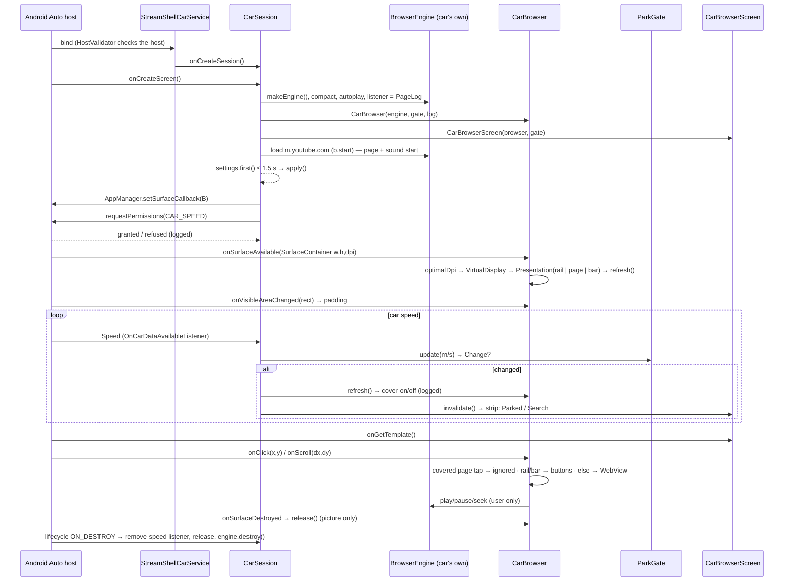

# Android Auto part — architecture and ParkGate (review of 2026-11-01, 0.6.1)

Status: code review plus JVM tests; **nothing here is tested in a car**. Statements about Android Auto's own behaviour
come from the Car App Library API and its documentation, not from measurements on the DS7.

## 1. Components

| File | Class / function | Role |
|---|---|---|
| `AndroidManifest.xml` | `StreamShellCarService`, category `androidx.car.app.category.NAVIGATION`; permissions `androidx.car.app.NAVIGATION_TEMPLATES`, `androidx.car.app.ACCESS_SURFACE`; `res/xml/automotive_app_desc.xml` | Registers StreamShell with Android Auto as a navigation app (needed to get a drawing surface). |
| `car/StreamShellCarService.kt` | `StreamShellCarService.createHostValidator()` | Release: only Google's Android Auto / AAOS hosts (`car_hosts.xml`); debug: any host. |
| | `onCreateSession()` → `CarSession` | One session per car connection, with its **own** `BrowserEngine`. |
| | `CarSession.onCreateScreen()` | Engine setup, settings flow, `AppManager.setSurfaceCallback(CarBrowser)`, speed permission, lifecycle observer. |
| | `CarSession.apply(settings)` | Ad skipping, diagnostics/trace flags, page diagnostics config, rail side. |
| | `CarSession.listenToSpeed()` | `CarHardwareManager.carInfo.addSpeedListener` → `ParkGate.update()` → `CarBrowser.refresh()` + `Screen.invalidate()`. |
| `car/ParkGate.kt` | `update()`, `onSpeed()`, `confirm()` / `confirmParked()`, `videoAllowed`, `needsConfirmation`, `Change` | Pure rule: picture allowed when stopped (< 0.5 m/s) or speed unknown and "Parked" confirmed; moving above 2 m/s; hysteresis in between. |
| `car/CarBrowser.kt` | `onSurfaceAvailable()` | Virtual display (`DisplayManager.createVirtualDisplay`, flags PRESENTATION + OWN_CONTENT_ONLY, own density from `CarDisplay.optimalDpi`) on the host's surface; `Presentation` with rail, page (WebView), cover, play bar. |
| | `refresh()` | **Shows / hides the black cover** (`cover` TextView over the page frame) from `gate.videoAllowed`. |
| | `onClick()`, `onScroll()` | Host touch callbacks → `MotionEvent`s into the presentation; taps on the page ignored while covered (rail and bar stay usable); drags only while allowed. |
| | `togglePlay()`, play bar `seekMedia` | The only places that change playback in the car (user-initiated). |
| | `onSurfaceDestroyed()` / `release()` | Ends the picture only; engine and sound stay with the session. |
| `car/CarScreens.kt` | `CarBrowserScreen.onGetTemplate()` | `NavigationTemplate` with one host action ("Parked" while speed unknown and not confirmed, else Search) + `Action.PAN`. |
| | `CarSearchScreen` | `SearchTemplate` (host keyboard). |
| `car/CarDisplay.kt` | `optimalDpi`, `clock`, `progress`, `scrollScript` | Pure layout rules. |
| `core/diag/DiagnosticsLog.kt` | `DiagnosticsHub` | Process-wide log; the car writes `car · …` lines into the same log as the phone. |

## 2. Call flow

## 3. Where the black overlay comes from

`CarBrowser.cover`: a black `TextView` inside the page frame, made visible in `CarBrowser.refresh()` when
`ParkGate.videoAllowed` is false. It is drawn by StreamShell inside its own presentation. **Android Auto does not draw
it**, and no browser or media component triggers it. The WebView keeps playing under it; the sound is not paused, muted
or stopped by the gate (checked by `CarArchitectureTest.theGateNeverTouchesAudio`).

## 4. Who decides what

| Behaviour | Decided by |
|---|---|
| Black cover over the page while moving / not confirmed parked; page taps ignored meanwhile | **StreamShell** (`ParkGate` + `CarBrowser.refresh/onClick`) |
| Sound controls on the cover (title/artist text, previous, play/pause, next — 0.6.2) | **StreamShell** |
| Pause for calls, quieter for navigation voices (0.6.2, `AudioCoordinator`) | **StreamShell** (watches audio mode and other apps' playback; holds no focus) |
| "Parked" button, single host button, pan button | **StreamShell** chooses; the host requires an action strip on `NavigationTemplate` and draws it |
| Density / layout of the car screen | **StreamShell** (`CarDisplay`) |
| Sound in the car | Phone audio routed by Android Auto; playback state only by StreamShell's play/pause/seek buttons |
| Which hosts may connect | **StreamShell** (`HostValidator`) |
| Whether the app is listed at all (Play installer / Unknown sources) | **Android Auto host** |
| Keyboard in `SearchTemplate` while driving, template size limits, which templates exist | **Android Auto host** |
| Where the host's own buttons sit (visible area) | **Android Auto host** (`onVisibleAreaChanged`) |
| Speed values and the `CAR_SPEED` permission | **Host / car** (`CarHardwareManager`) |
| UX restrictions on Android Automotive OS (`CarUxRestrictions`) | **AAOS** — not used: StreamShell is a phone app projected by Android Auto, not an AAOS app |

**Honest finding:** the picture rule is StreamShell's own logic; the host does not inspect what is drawn on a
navigation app's surface. It stays in place on purpose (safety decision for this project), and this review changed
nothing about it.

## 5. Scope: phone, external displays, car

- **Phone playback** (`BrowserViewModel`, the phone's `BrowserEngine`, `PlaybackService`, `MediaBridge`, PiP,
  background audio, fullscreen): never consults `ParkGate` (`CarArchitectureTest.parkGateIsUsedOnlyByTheCarPart`).
  The car session has its own engine, WebViews and page id; the phone's engine is not shared.
- **External displays / casting of the phone's screen:** not affected (no ParkGate code there). The car's virtual
  display is private (`OWN_CONTENT_ONLY`) and exists only on Android Auto's surface.
- **Shared between phone and car:** the WebView (Chromium) process, cookies/sign-in, the audio output, the settings
  and — since 0.6.1 — the diagnostics log. Phone and car can play sound at the same time; there is no coordination
  between the two (untested how WebView handles audio focus there).

## 6. What Android Auto supports officially (as far as documented)

- **Media apps** (`MediaBrowserService` / Media3 `MediaLibraryService`): browse lists and a now-playing screen drawn by
  the host; audio only, no video.
- **Template apps** (navigation, POI, messaging, IoT…): host-drawn templates; only navigation apps get a surface.
- **Video / browsers:** no official category on Android Auto projection. Video apps exist on some Android Automotive OS
  cars and only while parked. StreamShell's surface use is unofficial (see ANDROID_AUTO.md).

## 7. Changes in this review (0.6.1)

- Lifecycles separated and documented: session (engine: page + sound) · surface (presentation: picture) · gate (cover
  and page taps). `onSurfaceDestroyed` releases the picture only.
- `ParkGate.update()` / `confirm()` return what changed; every change is logged (`car · gate: speed stopped → moving,
  picture on → off`). Also logged: session start/end, settings read, permission result, speed listener, surface
  available (size, car dpi → chosen dpi), visible area, cover on/off, first ignored page tap, presentation errors, the
  car page's own diagnostics lines.
- The car session follows settings changes live (ads, diagnostics) instead of reading them once.
- No dialogs added; the only car-screen text is the existing cover message.

## 8. Test plan

| # | Scenario | Expected |
|---|---|---|
| P1 | Phone: play a video, minimize, PiP, fullscreen, background audio (no car connected) | Unchanged; log has no `car ·` lines |
| P2 | Phone: video playing, connect Android Auto, open StreamShell in the car | Phone video unaffected by the car's gate; log: `car · session started …` |
| P3 | Phone: switch Diagnostics off/on while the car session runs | Car lines stop / start at once |
| A1 | Car, parked (speed reported 0) | `car · gate: speed unknown → stopped, picture off → on`; no cover |
| A2 | Car starts moving | `gate: … → moving, picture on → off`; cover on; sound continues; rail and play bar work |
| A3 | Car stops | Cover off once the car reports standing still (below 0.5 m/s) |
| A4 | Speed permission refused | `car speed permission refused …`; "Parked" button; tap → `"Parked" tapped: …`; cover off |
| A5 | Tap on the covered page | One line `tap on the covered page ignored …`; nothing happens on the page |
| A6 | Switch to the map app and back | `surface destroyed …` then `surface available …`; sound kept playing meanwhile |
| A7 | Disconnect the car | `session ended …`; phone app unaffected |
| X1 | Phone screen mirrored / external display (desktop mode, cast) | No cover, no gate lines; behaves like the phone |
| X2 | Android Auto Desktop Head Unit (debug build) with simulated speed | Same as A1–A3 |
